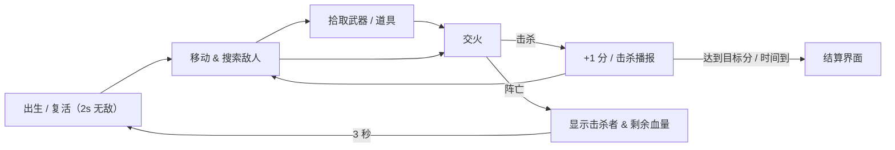
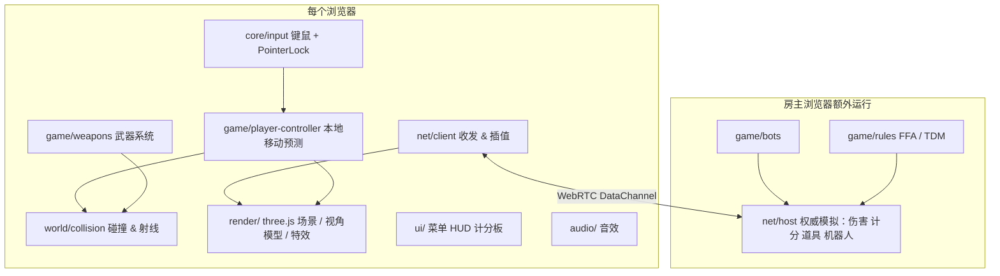
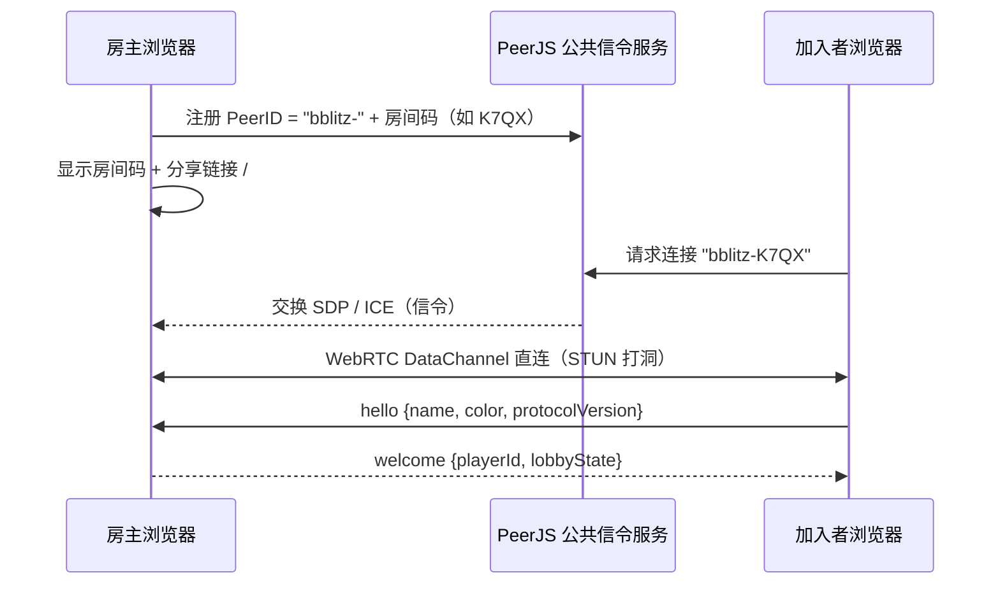
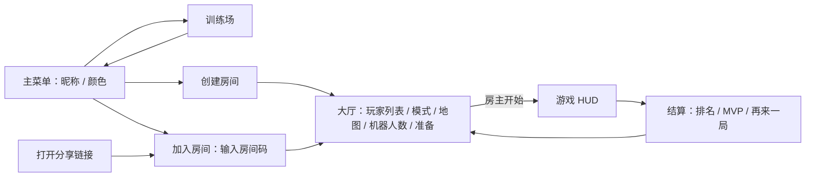
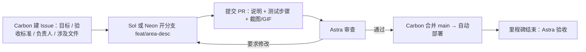

# 《Block Blitz · 方块闪击》游戏设计文档（GDD v0.1）

> 代号暂定，可随时改名。
> 一句话定位：**浏览器里点开链接就能玩的低门槛 3D 第一人称射击，好友之间发个房间码就能 P2P 对战，部署在 GitHub Pages，零服务器成本。**

| 项目 | 内容 |
|---|---|
| 平台 | 桌面浏览器（Chrome / Edge / Firefox）+ **手机浏览器（Android Chrome / iOS Safari，横屏触屏）**，PC 与手机可同房间混玩 |
| 技术栈 | HTML5 + TypeScript + three.js + Vite + PeerJS（WebRTC） |
| 托管 | GitHub Pages（GitHub Actions 自动构建部署） |
| 人数 | 单人训练（打机器人）/ 联机 2–6 人（推荐 2–4 人） |
| 时长 | 单局 5–6 分钟 |
| 难度 | 低：高容错、快速复活、自动回血、机器人很“菜” |
| 美术 | 低多边形 / 方块风，纯色材质 + 少量 CC0 素材，首包 < 5 MB |

---

## 1. 设计目标与原则

1. **打开即玩**：不注册、不下载、不装插件。首页 3 秒内可进入训练场。
2. **低难度 · 高爽感**：死亡代价低（3 秒复活），击杀反馈强（音效、击中标记、击杀播报）。
3. **轻 PvP**：PvP 是“朋友间的打闹”，不是竞技。不做排位、不做经济系统。
4. **零运维**：纯静态站点，联机走 WebRTC P2P，只依赖免费公共信令服务。
5. **可被 AI 团队协作开发**：模块边界清晰、接口先行、参数集中配置、逻辑可单测。

### 不做（Out of Scope，v1）
- 账号系统、排行榜、内购
- 专用服务器 / 大规模匹配
- 手柄支持（V2 再考虑）
- Service Worker 离线缓存（避免缓存旧版本导致联机协议不一致）
- 复杂骨骼动画角色、写实画面
- 严格反作弊（好友局，做基础校验即可）

---

## 2. 核心玩法

### 2.1 游戏循环



### 2.2 游戏模式

| 模式 | 阶段 | 说明 | 胜利条件 |
|---|---|---|---|
| 训练场 | MVP | 单人离线，打移动靶 + 机器人，可调机器人数量 | 无（自由练习） |
| 自由混战 FFA | MVP | 人人为敌，人数不足自动用机器人补位 | 先到 15 杀 或 6 分钟结束时分数最高 |
| 团队死斗 TDM | V1 | 红蓝两队，2v2 / 3v3，可混机器人 | 队伍先到 30 杀 或 6 分钟 |
| 合作守波 Co-op（可选） | V2 | 2–4 人合作抵抗机器人波次，降低 PvP 压力 | 撑过 10 波 |

### 2.3 降低难度的设计手段

- 血量 100，**4 秒未受伤后每秒回 15 血**。
- 复活 3 秒，复活后 **2 秒无敌**（期间开火则提前结束无敌）。
- 爆头判定框比视觉模型大 20%，身体判定框比模型大 10%。
- 无掉落伤害；火箭自伤只有 30%。
- 自动换弹（弹匣打空自动换）、默认武器子弹无限（只有弹匣限制）。
- 准星颜色变化：瞄准敌人时变红（轻量瞄准提示，不做吸附）。
- 机器人：反应延迟 600 ms、命中率约 25%，不会预判跳跃。
- 被击杀后显示“击杀者剩余血量”，让新手知道对方也快死了，降低挫败。
- **落后补偿（可开关）**：分数最低的玩家复活时获得 5 秒 +15% 移速。

### 2.4 好玩的点（爽感来源）

- **火箭跳**：火箭爆炸有强击退，自伤低，鼓励玩家飞来飞去。
- **跳板**：地图上的弹射板，可以把人弹到高台。
- **冲刺**：Shift 短冲刺（6 m，3 秒冷却），躲子弹、追人都好用。
- **平底锅**：近战武器，敲中有夸张的“铛”声和击飞效果。
- **击杀播报**：双杀 / 三杀 / 暴走 / 终结（终结别人连杀时播报）。
- **快捷语音气泡**：按 `T` 弹出 4 个预设表情（👍 / 😂 / 😡 / GG），头顶显示 2 秒。

---

## 3. 操作

| 按键 | 功能 |
|---|---|
| 鼠标移动 | 视角（Pointer Lock） |
| 左键 / 右键 | 开火 / 武器副功能（狙击开镜、霰弹无） |
| W A S D | 移动 |
| Space | 跳跃 |
| Shift | 冲刺 |
| R | 手动换弹 |
| 1 / 2 / 3 / 滚轮 | 切换武器 |
| Q | 切换到上一把武器 |
| T | 快捷表情 |
| Tab（按住） | 计分板 |
| Esc | 暂停菜单 / 释放鼠标 |

设置项：鼠标灵敏度、触屏灵敏度、FOV（70–110）、Y 轴反转、主音量 / 音效音量、画质（低 / 中 / 高：阴影、像素比、抗锯齿）、显示帧率、自动开火（手机默认开）。设置保存在 `localStorage`。

### 3.1 输入抽象（PC / 手机共用）

游戏逻辑**只读取统一的 `InputState`**，不直接监听键盘或触摸：

```ts
interface InputState {
  moveX: number; moveY: number;      // -1..1
  lookDX: number; lookDY: number;    // 本帧视角增量（弧度）
  fire: boolean; altFire: boolean;
  jump: boolean; dash: boolean; reload: boolean;
  weaponSlot: 0 | 1 | 2 | null; prevWeapon: boolean;
  emote: 0 | 1 | 2 | 3 | null;
}
```

输入源：`core/input/keyboard-mouse.ts`、`core/input/touch.ts`（V2 可加 `gamepad.ts`）。检测到触摸时自动切换到触屏 UI。

### 3.2 手机触屏操作

| 区域 / 按钮 | 功能 |
|---|---|
| 左半屏 | 浮动虚拟摇杆（手指按下处出现）控制移动，推到边缘自动奔跑 |
| 右半屏拖动 | 转动视角 |
| 开火键（右下大按钮） | 按住开火，**按住的同时可拖动转视角** |
| 跳跃 / 冲刺 / 换弹 | 开火键周围小按钮 |
| 顶部武器图标 | 点击切换武器 |
| 表情键 | 弹出 4 个表情 |
| 计分板键 | 右上角，点按显示 |

手机专属的低难度辅助（**仅触屏玩家生效**，平衡 PC 键鼠优势）：
- **自动开火**（默认开）：准星对准敌人且在射程内时自动开火，可在设置关闭。
- **瞄准辅助**：准星经过敌人时视角灵敏度降低 40%，并有轻微吸附。
- 命中时轻微震动（`navigator.vibrate`，仅 Android）。

适配要求：
- 必须横屏，竖屏时显示“请旋转手机”提示。
- 全屏：Android 用 Fullscreen API；iOS Safari 引导“添加到主屏幕”（提供 `manifest.webmanifest`，`display: fullscreen`）。
- 使用 Pointer Events 处理多点触控，`touch-action: none`，禁止双击缩放、长按菜单、iOS 橡皮筋回弹。
- 按钮位置适配刘海 / 安全区（`env(safe-area-inset-*)`），按钮大小 ≥ 56 px。
- 菜单、大厅、结算界面响应式布局，手机上可正常操作。

---

## 4. 角色与数值

> 所有数值集中放在 `src/config/` 中，方便调参，**禁止在逻辑代码里写死数值**。

### 4.1 玩家

| 参数 | 值 |
|---|---|
| 血量 | 100 |
| 回血 | 4 s 未受伤后 15 HP/s |
| 移动速度 | 7 m/s（空中操控 0.6 倍） |
| 跳跃高度 | ≈ 1.4 m |
| 冲刺 | 0.15 s 内位移 6 m，冷却 3 s |
| 碰撞体 | 胶囊，半径 0.4 m，高 1.8 m，眼高 1.6 m |
| 复活 / 无敌 | 3 s / 2 s |
| 外观 | 方块机器人，玩家自选主题色，头顶名字条 |

### 4.2 武器

| 武器 | 获取 | 类型 | 伤害（身/头） | 射速 | 弹匣 | 备注 |
|---|---|---|---|---|---|---|
| 爆能枪 Blaster | 默认 | 即时命中 | 12 / 18 | 8 发/s | 30（无限备弹） | 小散布，稳定好用 |
| 平底锅 Pan | 默认 | 近战 | 50 | 1.6 次/s | — | 距离 2 m，击退 |
| 霰弹枪 Scatter | 地图拾取 | 即时命中 ×8 弹丸 | 8 / 12 每颗 | 1.1 发/s | 6，拾取带 18 发 | 10 m 后伤害衰减 |
| 火箭筒 Boomer | 地图拾取 | 弹道 25 m/s | 直击 80，溅射 ≤ 60 | 1 发/s | 1，拾取带 6 发 | 溅射半径 3.5 m，强击退，自伤 30% |
| 电磁炮 Rail | 地图拾取（稀有） | 即时命中 + 光束特效 | 70 / 100 | 0.8 发/s | 1，拾取带 5 发 | 右键开镜 |

玩家同时携带：爆能枪 + 平底锅 + 1 把拾取武器（拾取新武器替换旧的）。死亡后拾取武器掉落消失。

### 4.3 道具 / 地图物件

| 物件 | 效果 | 刷新 |
|---|---|---|
| 医疗包 | +50 HP | 20 s |
| 护盾 | +50 护甲（先扣护甲） | 30 s |
| 加速 | 8 s 内 +30% 移速 | 40 s |
| 双倍伤害 | 10 s 内伤害 ×2，角色发光 | 60 s，地图中心，有倒计时提示 |
| 跳板 | 垂直/斜向弹射 | 常驻 |

---

## 5. 地图

### 5.1 设计要求
- 尺寸约 60 m × 60 m，2–3 层高度差，适合 2–6 人，**30 秒内能跑完一圈**。
- 至少 8 个出生点，复活时选择“离所有敌人最远”的出生点。
- 中心区域放强力道具（双倍伤害），制造冲突点；边缘放医疗包。
- 全部由方块（AABB）拼成，碰撞和射线检测简单可靠。

### 5.2 地图列表
1. **方块广场 Block Plaza**（MVP）：中央高台 + 四角掩体 + 两个跳板。
2. **货柜码头 Dockyard**（V1）：集装箱迷宫 + 吊车高点，偏狭长。

### 5.3 地图数据格式（JSON，数据驱动）

```jsonc
{
  "id": "block-plaza",
  "name": "方块广场",
  "size": [60, 60],
  "skyColor": "#87ceeb",
  "boxes": [ { "min": [-30, -1, -30], "max": [30, 0, 30], "mat": "ground" } ],
  "spawns": [ { "pos": [-25, 0, -25], "yaw": 0.78 } ],
  "pickups": [ { "type": "health", "pos": [0, 0, 20] } ],
  "jumpPads": [ { "pos": [10, 0, 0], "impulse": [0, 14, 4] } ],
  "waypoints": [ { "id": 0, "pos": [0, 0, 0], "links": [1, 2] } ]
}
```

`waypoints` 供机器人寻路使用（手工放置的路点图，A* 搜索）。

---

## 6. 机器人 AI（仅在房主端运行）

状态机：`巡逻 → 发现目标 → 追击 → 射击 → 撤退（低血量找医疗包）`

| 难度参数 | 简单（默认） | 普通 |
|---|---|---|
| 反应延迟 | 600 ms | 350 ms |
| 命中率 | ~25% | ~45% |
| 视野 | 90°，30 m | 110°，40 m |
| 会用冲刺 / 跳板 | 否 | 是 |

机器人对网络来说就是“由房主控制的玩家”，走同一套玩家/伤害/计分逻辑。

---

## 7. 技术架构

### 7.1 技术选型

| 领域 | 方案 | 理由 |
|---|---|---|
| 语言 | TypeScript（strict） | 多 agent 协作时接口约束清晰，审查更容易 |
| 构建 | Vite | 快、零配置、静态产物直接上 Pages |
| 渲染 | three.js | 需求本身指定，生态成熟 |
| 物理 / 碰撞 | **自研**：胶囊 vs AABB + 射线 vs AABB | 地图全是方块，不需要物理引擎，体积小、可预测、可单测 |
| 联机 | PeerJS（WebRTC DataChannel） | 用房间码即可连接，自带免费公共信令服务器 |
| 联机备选 | Trystero（BitTorrent/Nostr 信令） | 通过 `Transport` 接口可替换，防 PeerJS 公共服务宕机 |
| UI | 原生 DOM + CSS | 界面简单，不引入 React，减小体积 |
| 音效 | WebAudio；CC0 音效（Kenney 等）或程序生成 | 无版权风险 |
| 测试 | Vitest（逻辑单测）+ Playwright（冒烟 e2e，可选） | |
| 部署 | GitHub Actions → GitHub Pages | push main 自动上线 |

### 7.2 模块划分



**关键原则：模拟层与渲染层分离。**
`world/`、`game/`（除视觉部分）、`net/protocol` 不得 import 渲染代码，保证能在 Node 里跑单元测试。数学类型可使用 three 的 `Vector3` 等纯数学类。

### 7.3 目录结构

```
Game1/
├─ index.html
├─ package.json · vite.config.ts · tsconfig.json
├─ public/
│  ├─ maps/            # 地图 JSON
│  ├─ sounds/          # CC0 音效
│  └─ models/          # 少量 glTF（可选）
├─ src/
│  ├─ main.ts          # 入口，组装各模块
│  ├─ config/          # 所有可调参数：player.ts weapons.ts net.ts bots.ts
│  ├─ shared/          # types.ts（全局类型/接口）math.ts
│  ├─ core/            # loop.ts（固定步长）events.ts input/（input-state.ts keyboard-mouse.ts touch.ts）
│  ├─ world/           # map-loader.ts collision.ts raycast.ts
│  ├─ game/            # player-controller.ts weapons/ pickups.ts rules/ bots/
│  ├─ net/             # transport.ts peerjs-transport.ts local-transport.ts
│  │                   # protocol.ts host.ts client.ts interpolation.ts
│  ├─ render/          # renderer.ts scene-builder.ts viewmodel.ts effects/
│  ├─ ui/              # menu/ lobby/ hud/ scoreboard/ settings/
│  └─ audio/           # audio-manager.ts
├─ tests/              # Vitest 单测
├─ docs/               # 本文档、协议文档、进度记录
└─ .github/workflows/deploy.yml
```

### 7.4 主循环

- **渲染**：`requestAnimationFrame`，跟随显示器刷新率。
- **模拟**：固定步长 60 Hz（累加器模式），保证移动/碰撞在不同帧率下一致。
- **网络发送**：客户端输入/状态 30 Hz；房主快照 20 Hz。
- **插值**：远端玩家使用 100 ms 缓冲插值，平滑显示。

---

## 8. 联机设计（P2P）

### 8.1 拓扑：星型 + 房主权威（轻量）

- 创建房间的玩家 = **房主（Host）**，其他人只连房主（星型），不全互联。
- 房主同时也是玩家：房主本地通过 `LocalLoopbackTransport` 连接自己的 Host 模拟，**代码路径与普通客户端完全一致**。
- 房主上行带宽有限，所以人数上限 6 人。

### 8.2 建立连接流程



- 房间码：4 位，去掉易混字符（0/O/1/I/L），碰撞时重新生成。
- 分享链接：`https://<user>.github.io/<repo>/#/room/K7QX`，点开直接进入加入流程。
- ICE：默认 Google 公共 STUN；`config/net.ts` 预留 TURN 配置项（可填 Metered 等免费额度）。
- GitHub Pages 是 HTTPS，满足 WebRTC 安全上下文要求。

### 8.3 同步策略

| 内容 | 权威方 | 方式 |
|---|---|---|
| 自己的移动 | 客户端（本地预测，立即响应） | 30 Hz 上报位置/朝向/速度，房主做速度上限校验 |
| 远端玩家显示 | 房主快照 | 20 Hz 快照 + 100 ms 插值 |
| 即时命中射击 | 客户端提交“命中声明”，房主校验 | 见 8.4 |
| 火箭弹道 | 房主模拟 | 客户端本地先播特效，以房主爆炸事件为准 |
| 血量 / 死亡 / 计分 / 道具 | 房主 | 可靠事件广播 |
| 机器人 | 房主 | 当作普通玩家放进快照 |

> 选择“客户端移动权威 + 命中声明”是为了**手感优先**：好友局延迟 50–150 ms 下也能“指哪打哪”，代价是作弊防护弱，可接受。

### 8.4 命中校验（房主端）

房主为每个玩家保存最近 500 ms 的位置历史。收到 `fire` 命中声明后检查：

1. 射速冷却、弹匣是否合法；
2. 射手存活，目标存活且不在无敌期；
3. 距离 ≤ 武器射程；
4. 回溯到“射击时刻”的目标位置，命中点与目标判定框误差 ≤ 0.5 m；
5. 射线不穿墙（对地图 AABB 做射线检测）。

全部通过 → 扣血并广播 `hit` / `kill` 事件；否则静默丢弃。

### 8.5 通道与消息协议

两条 DataConnection：
- **reliable**（有序可靠）：大厅、事件、聊天、比赛状态；
- **unreliable**（无序不可靠）：输入上报、快照。
  （PeerJS 不可靠通道参数需在 M0 实测确认。）

序列化：v1 用 JSON（便于调试），协议字段名保持简短；如带宽吃紧，V1 后改为二进制（`ArrayBuffer` + `DataView`）。

| 方向 | 消息 | 关键字段 |
|---|---|---|
| C→H | `hello` | name, color, protocolVersion |
| H→C | `welcome` / `reject` | playerId, lobby / 原因（版本不符、房间满） |
| H→C | `lobby` | players[], mode, map, botCount, hostId |
| C→H | `ready` / `config`（仅房主） | — / mode, map, botCount |
| H→C | `matchStart` | seed, map, spawns, startTime |
| C→H | `state`（30 Hz） | seq, t, pos, vel, yaw, pitch, flags |
| C→H | `fire` | seq, t, weapon, origin, dir, hits[{targetId, point, head}] |
| H→C | `snap`（20 Hz） | tick, players[{id,pos,yaw,pitch,hp,armor,weapon,flags}], projectiles[], pickups[] |
| H→C | `ev` | type: hit / kill / spawn / pickup / explode / streak / emote, payload |
| H→C | `matchEnd` | scores[], mvp |
| 双向 | `ping` / `pong` | t（计算延迟，计分板显示） |

所有消息类型在 `src/net/protocol.ts` 定义为 TypeScript 可辨识联合类型（discriminated union），附 `protocolVersion` 常量；**协议改动必须同步更新 `docs/PROTOCOL.md` 并提升版本号**。

### 8.6 异常处理

| 情况 | 处理 |
|---|---|
| 客户端断线 | 房主 5 s 超时后移除，其他人看到“XX 离开了” |
| 房主断线 | v1：比赛结束，所有人回到主菜单并提示；V2 考虑房主迁移 |
| 打洞失败 | 10 s 连接超时，提示“网络无法直连，可尝试换网络或配置 TURN” |
| 信令服务不可用 | 提示错误；可在设置中切换到 Trystero 备选信令 |
| 版本不一致 | `reject` 并提示双方刷新页面 |
| 页面切到后台 | 房主切后台会导致 rAF 暂停：房主模拟改用 `setInterval`/Worker 驱动，避免全房卡死 |

### 8.7 本地开发联机

`LocalTransport` 基于 `BroadcastChannel`，**同一台电脑开两个标签页即可联机测试**，不依赖 PeerJS 和外网。通过 URL 参数切换：`?net=local`。

---

## 9. 界面流程



HUD 元素：准星（命中时出现 X 标记）、血量 + 护甲、弹药、当前武器、击杀信息流（右上）、比分 + 倒计时（顶部中央）、受击方向指示、道具倒计时、延迟/帧率（可选）。

首次进入训练场显示 5 步操作提示（移动 → 跳 → 冲刺 → 开火 → 捡武器），可跳过，完成后记录在 `localStorage`。

---

## 10. 美术与音效

- **风格**：低多边形 + 纯色 + 柔和光照，明亮卡通色调；角色为方块机器人（头/身/手枪），用 three 基础几何体组装，无需建模软件。
- **视角模型**：第一人称手持武器用简单几何体拼装，开火有后坐抖动 + 枪口闪光。
- **特效**：命中火花（粒子）、弹道轨迹（短线段淡出）、火箭爆炸（球体扩散 + 屏幕震动）、受击屏幕边缘泛红。
- **性能预算**：Draw call < 150；地图静态方块合并（`BufferGeometryUtils.mergeGeometries` 或 InstancedMesh）；阴影只给一盏方向光，低画质关闭。
- **音效**：开火、命中（不同于被击中）、爆头“叮”、击杀确认、跳板、拾取、平底锅“铛”、播报语音（可用 TTS 预生成或文字 + 音效代替）。全部 CC0。
- **目标**：集成显卡笔记本 1080p 稳定 60 FPS；中端手机（近 3 年 Android / iPhone 11 以上）稳定 ≥ 30 FPS，争取 60。
- **手机画质预设**：默认“低”——像素比 ≤ 1.0–1.5、关闭阴影与 MSAA、粒子数减半；首次进入时根据帧率自动降档。

---

## 11. 部署（GitHub Pages）

1. `vite.config.ts` 设置 `base: '/<仓库名>/'`（或用环境变量）。
2. `.github/workflows/deploy.yml`：push 到 `main` → `npm ci` → `npm run test` → `npm run build` → `actions/upload-pages-artifact` → `actions/deploy-pages`。
3. 仓库 Settings → Pages → Source 选 “GitHub Actions”。
4. 使用 hash 路由（`#/room/XXXX`），避免 Pages 不支持 SPA 回退的问题。
5. 构建产物带内容哈希，避免缓存旧版本导致协议不一致；页面显示版本号。

---

## 12. 里程碑计划

| 里程碑 | 内容 | 验收标准 |
|---|---|---|
| **M0 骨架 & 风险验证** | Vite + TS 工程、ESLint/Prettier、Vitest、CI + Pages 自动部署；PeerJS 联机 spike；菜单 UI 外壳（响应式，手机可用） | 线上地址可访问；电脑 + 手机（4G）通过房间码互发消息成功 |
| **M1 单机核心** | 地图加载、输入抽象（键鼠 + 基础触屏）、第一人称移动 + 碰撞 + 跳跃 + 冲刺、爆能枪 + 平底锅、移动靶、基础 HUD、主循环 | 训练场在电脑和手机上都可玩，无穿墙/卡墙 |
| **M2 联机 MVP** | Transport 抽象（PeerJS + Local）、大厅、移动同步与插值、射击命中校验、伤害/死亡/复活、FFA 规则、结算 | 3 人（含 1 台手机）跨网络完整打完一局 FFA，无明显瞬移/卡顿 |
| **M3 内容** | 霰弹/火箭/电磁炮、道具、跳板、机器人 AI、音效、击杀播报、表情、完整触屏操作 + 自动开火 + 瞄准辅助 | 机器人补位的 4 人局体验完整，“好玩” |
| **M4 打磨** | TDM、第二张地图、设置界面、新手引导、断线/异常处理、性能优化、手机画质自动降档、PWA 添加到主屏幕 | 异常场景都有提示；中端手机 ≥ 30 FPS |
| **M5 发布** | 全面测试、README（玩法 + 部署说明）、版本 v1.0 | Astra 终审通过，正式公开链接 |

---

## 13. AI 团队分工与协作流程

### 13.1 角色

> 具体如何调度（模型 ID、`delegate_task` 参数、任务简报模板、审查循环、冲突处理）见 **[ORCHESTRATION.md](ORCHESTRATION.md)**。

| 成员 | 角色 | 职责 | 主要负责目录 |
|---|---|---|---|
| **Carbon** | 主控 / 技术负责人 | 按里程碑拆任务（Issue）、定义并守护接口（`shared/types.ts`、`net/protocol.ts`）、分配任务、合并 PR、集成测试、维护 `docs/PROGRESS.md` | `shared/`、`main.ts`、`docs/` |
| **6.2 Sol** | 主力开发 | 引擎核心与难点：主循环、玩家控制器、碰撞/射线、武器框架、联机（Transport / Host / Client / 插值 / 命中校验） | `core/`、`world/`、`net/`、`game/`（核心） |
| **Neon** | 协助开发 | UI/HUD/菜单、**手机触屏操作与适配**、音效、地图数据与场景构建、特效、机器人 AI、设置；**为 Sol 的模块编写单元测试**（交叉验证） | `ui/`、`core/input/touch.ts`、`audio/`、`render/effects/`、`game/bots/`、`public/maps/`、`tests/` |
| **6.2 Astra** | 审查 | 审查所有 PR（正确性、联机一致性、性能、安全、可维护性）；每个里程碑做验收测试；**不写功能代码**，保持独立 | — |

> Sol 与 Neon 互助方式：Sol 先提交接口与核心实现 → Neon 基于接口并行做 UI/内容，并给 Sol 的代码写测试；Neon 遇到核心问题由 Sol 支援；双方可互相做“预审”，再交 Astra 正式审查。

### 13.2 工作流



### 13.3 协作规则

1. **接口先行**：跨模块接口改动（`shared/`、`protocol.ts`）必须由 Carbon 批准，并单独提 PR。
2. **文件归属**：同一时间一个文件只由一人修改，避免冲突；需要改他人目录时先在 Issue 里沟通。
3. **小 PR**：单个 PR 建议 < 400 行变更，聚焦一个功能。
4. **参数集中**：数值全部放 `src/config/`，便于策划调参与审查。
5. **完成定义（DoD）**：`npm run build`、`npm run lint`、`npm run test` 全通过；有手动测试步骤；涉及联机的功能需用 `?net=local` 双标签页验证。

### 13.4 Astra 审查清单

- [ ] 是否符合本 GDD 与 Issue 验收标准
- [ ] TypeScript strict 无报错，协议相关代码无 `any`
- [ ] 模拟层没有 import 渲染层
- [ ] 热循环中没有每帧 `new Vector3()` 等分配；three 资源有 `dispose()`
- [ ] 联机：协议改动已更新 `PROTOCOL.md` 和版本号；房主校验覆盖新输入
- [ ] 断线、重复消息、乱序消息不会导致崩溃
- [ ] 数值未写死在逻辑代码里
- [ ] 有对应单元测试（纯逻辑部分）
- [ ] 无性能回退（帧率、draw call）
- [ ] 第三方素材为 CC0 / 许可兼容，并记录在 `CREDITS.md`

### 13.5 代码约定

- 单位：米、秒、弧度；坐标系 Y 轴向上（three 默认）。
- 命名：文件 `kebab-case.ts`，类 `PascalCase`，常量 `UPPER_SNAKE_CASE`。
- 模块通过 `core/events.ts` 的类型化事件总线通信，避免互相直接引用 UI。
- 提交信息：`feat(net): ...` / `fix(world): ...` / `docs: ...`（Conventional Commits）。

---

## 14. 测试策略

| 层级 | 内容 | 工具 |
|---|---|---|
| 单元测试 | 碰撞/射线、武器冷却与伤害、命中校验、计分规则、协议编解码、插值 | Vitest |
| 本地联机 | 双/多标签页 `?net=local` | 手动 + Playwright（可选） |
| 真实网络 | 不同家庭网络 / 手机热点 / 公司网络互连 | 手动，每里程碑一次 |
| 弱网模拟 | 人为延迟 150 ms、丢包 5%（在 Transport 层加调试开关） | 内置调试开关 |
| 性能 | FPS / draw call / 内存（`renderer.info`） | 调试面板 |

---

## 15. 风险与对策

| 风险 | 影响 | 对策 |
|---|---|---|
| 部分 NAT（对称型、公司网）无法打洞 | 部分玩家连不上 | 明确报错；预留 TURN 配置；文档说明可用手机热点 |
| PeerJS 公共信令不稳定 | 无法建房 | Transport 抽象，备选 Trystero；可自建 PeerServer（免费云平台） |
| 房主掉线整局结束 | 体验差 | v1 接受，提示清晰；V2 做房主迁移 |
| 客户端权威易作弊 | 不公平 | 好友局定位；房主做速度、射速、距离、视线校验 |
| 房主浏览器切后台卡死 | 全房卡顿 | 房主模拟不依赖 rAF |
| 浏览器兼容（Safari Pointer Lock / WebRTC） | 部分用户无法玩 | 以 Chromium 为主测平台，首页给出兼容提示 |
| 手机 4G 运营商级 NAT 打洞失败率更高 | 手机玩家连不上 | 优先让 PC/家宽玩家当房主；预留 TURN；连接失败时提示切换 Wi-Fi |
| 手机性能不足 / 发热 | 卡顿 | 低画质默认、自动降档、限制像素比、合并几何体 |
| iOS Safari 限制（无 Fullscreen API、音频需用户手势解锁） | 体验差 | 引导添加到主屏幕；首次点击时解锁 AudioContext |
| 范围蔓延 | 延期 | 严格按里程碑，V2 内容不提前做 |

---

## 16. 已确认决策（2026-11-24，产品负责人确认）

| # | 问题 | 决策 |
|---|---|---|
| 1 | 游戏名 | **Block Blitz · 方块闪击**，仓库名 `block-blitz` |
| 2 | 美术风格 | 方块机器人 + 低多边形 + 明亮卡通色 |
| 3 | 人数上限 | 6 人（推荐 2–4） |
| 4 | 语言 | v1 只做中文；所有界面文字集中在 `src/ui/strings.ts`，为 V2 英文做准备 |
| 5 | 移动端 | **v1 支持手机**（横屏触屏），PC 与手机可混玩，见 §3.2 |
| 6 | Co-op 模式 | V2 可选，不进入 v1 范围 |
| 7 | 语言/工具 | TypeScript（strict）+ Vite |

> 产品负责人授权：GDD 范围内的技术与设计细节由 Carbon 自主决定，无需请示。只有“改变玩法范围 / 需要真人真机测试 / 需要花钱或账号操作”时才找产品负责人。
