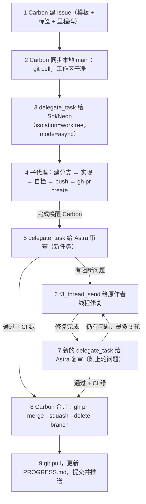

# Block Blitz 调度手册（给主控 Carbon）

> 本文件是主控的操作手册。**Carbon 每次开始工作（包括新会话接手）都先读：本文件 → `docs/PROGRESS.md` → `AGENTS.md` → `docs/GAME_DESIGN.md`。**
> 产品负责人（用户）是“甩手掌柜”：GDD 范围内的事 Carbon 自己拍板，不要请示。

---

## 0. 基本信息

| 项 | 值 |
|---|---|
| 本地仓库 | `E:\CodexProjects\Game1` |
| GitHub | https://github.com/daoguang1012/block-blitz |
| 线上地址 | https://daoguang1012.github.io/block-blitz/ （M0 部署后生效） |
| 默认分支 | `main`（只通过 PR 合入代码；Carbon 可直接提交 `docs/PROGRESS.md` 等纯文档） |
| GitHub 账号 | 所有 agent 共用 `daoguang1012`（gh CLI 已登录）。**同账号不能 approve 自己的 PR**，所以审查结论用 PR 评论表达，合并由 Carbon 执行 |
| 运行环境 | T3 Code，Windows + PowerShell，Node 24 / npm 11 / git / gh 均已安装 |

---

## 1. 团队与模型

| 成员 | 角色 | `delegate_task` 的 `target` | 推荐档位 |
|---|---|---|---|
| **Carbon**（你） | 主控：拆任务、建 Issue、派活、守接口、合并、记进度 | 本会话：Antigravity · `gemini-4-carbon`，thought_level `high` | — |
| **Sol** | 主力开发：core / world / net / game 核心 | `{"providerInstanceId":"codex","model":"gpt-6.2-sol","options":[{"id":"reasoningEffort","value":"high"}]}` | 默认 `high`；联机/碰撞/命中校验等难题用 `xhigh` |
| **Neon** | 协助开发：UI / 触屏 / 音效 / 地图 / 特效 / 机器人 / 测试 | `{"providerInstanceId":"antigravity","model":"gemini-4-neon","options":[{"id":"thought_level","value":"high"}]}` | 默认 `high` |
| **Astra** | 审查：PR 审查、里程碑验收，不写功能代码 | `{"providerInstanceId":"codex","model":"gpt-6.2-astra","options":[{"id":"reasoningEffort","value":"high"}]}` | 默认 `high`；里程碑验收用 `xhigh` |

> 首次 `delegate_task` 前调用一次 `orchestrator_capabilities` 核对模型 ID 与 options 格式；若与上表不符，以工具返回为准并更新本表。
> 某个模型不可用时：**不要擅自换成别的模型**，在 `PROGRESS.md` 记录并告知用户。

---

## 2. 一个任务的完整生命周期



### 步骤细则

1. **建 Issue**
   ```powershell
   gh issue create --title "[M0] 工程脚手架与部署管线" --body-file <临时文件> --label "owner:sol,area:infra,type:feat" --milestone "M0 骨架&风险验证"
   ```
   Issue 正文按 `.github/ISSUE_TEMPLATE/task.md`：目标、验收标准、允许修改的文件、依赖、GDD 章节引用。

2. **派活前同步**：worktree 是从 Carbon 当前提交创建的，**未提交的改动不会带过去**。派活前必须 `git pull` 且 `git status` 干净。

3. **派活**（`delegate_task`）
   - `isolation: "worktree"`（每个开发任务独立检出，Sol 和 Neon 并行互不干扰）
   - `mode: "async"`，`role: "implementation"`
   - `title`：`#<Issue号> <简短标题>`
   - `task`：用第 4 节的简报模板，**自包含**（子代理看不到本会话历史）
   - 派完立刻记下 `taskId` 到 `PROGRESS.md` 的“进行中”表

4. **等待**：派完就结束当前回合或做别的事。子代理完成时系统会唤醒你；**不要轮询** `task_status`，不要 sleep。

5. **审查**：读取作者结果（最后一行是 `PR <URL>, head <SHA>, checks <state>`），先 `link_pull_request` 关联 PR，再 `delegate_task` 给 Astra（`role:"review"`，`isolation:"worktree"`，用审查模板）。

6. **修复**：Astra 给出阻断（Blocker）或重要（Major）问题时，用 `t3_thread_send` 发给**原作者的子线程**（保留上下文，在同一分支上修），附 Astra 的问题清单。只有琐碎问题（拼写、注释、一行改动）Carbon 可以自己在该分支上改。

7. **复审**：每次复审都是**新的** `delegate_task` 给 Astra（不要 `t3_thread_send` 给旧的审查线程），附上一轮问题和作者的修复说明。
   - 最多 3 轮。第 3 轮仍不过：Carbon 裁决（接受并开后续 Issue / 拆分任务 / 换人重做）。

8. **合并条件**：Astra 结论为 `APPROVE` + CI 全绿 + 无冲突。
   ```powershell
   gh pr merge <号> --squash --delete-branch
   ```
   有冲突：让原作者 rebase 到最新 main 后再合（`t3_thread_send`）。

9. **收尾**：`git pull`，更新 `PROGRESS.md`（完成项、下一步），`git commit -m "docs: progress"` 并 push。

---

## 3. 并发与依赖规则

- 同时最多 **2 个开发任务**（Sol 1 个 + Neon 1 个）+ **2 个审查任务**。
- 并行的两个开发任务**修改的文件不能重叠**。Issue 中必须写明“允许修改的文件/目录”。
- **共享文件**由 Carbon 串行化：
  - `package.json` / `package-lock.json`：只有 Sol 的任务或 Issue 明确授权时才能加依赖；Neon 需要依赖时写在 PR 说明里，由 Carbon 安排。
  - `src/shared/**`、`src/net/protocol.ts`：接口变更单独开 Issue，由 Sol 实现，Carbon 批准后才能被其他任务依赖。
  - `src/main.ts`：集成入口，同一时间只允许一个任务改。
- 依赖顺序：脚手架（M0-1）合并之前不派其他代码任务。被依赖的接口 PR 合并后，再派依赖它的任务。
- 一个任务目标控制在**一个 PR、< 400 行变更、子代理一次能完成**。太大就拆。

---

## 4. 任务简报模板

### 4.1 开发任务（给 Sol / Neon）

```text
你是 Block Blitz（浏览器 3D 第一人称射击，three.js + TypeScript + Vite，P2P 联机，部署 GitHub Pages，支持 PC 与手机）项目的{主力开发 Sol | 协助开发 Neon}。
仓库：https://github.com/daoguang1012/block-blitz ，你在一个独立 worktree 中工作。

开始前必读：AGENTS.md；docs/GAME_DESIGN.md 的 {§x, §y}；{其他相关文件}。

任务：Issue #{号} {标题}（gh issue view {号} 查看全文）
目标：{一两句话}
验收标准：
- {可验证的条目 1}
- {可验证的条目 2}
允许修改：{文件/目录列表}
禁止：修改上述范围以外的文件；修改 src/shared/ 与 src/net/protocol.ts（除非本任务授权）；新增依赖（除非本任务授权：{允许的依赖}）。
依赖/上下文：{已合并的相关 PR、可用的接口}

完成流程：
1. git switch -c feat/{号}-{slug}
2. 实现；纯逻辑写 Vitest 单测
3. 依次运行 npm run typecheck、npm run lint、npm run test、npm run build，全部通过
4. 提交（Conventional Commits，如 feat(net): ...），git push -u origin HEAD
5. gh pr create，标题 "[#{号}] {标题}"，正文按 PR 模板填写，包含 "Closes #{号}"、手动测试步骤、UI 改动附截图说明
6. 回复我：做了什么、偏离 GDD 的地方及原因、已知问题、需要 Carbon 决定的事
约束：不要启动子代理；不要合并 PR；不要 watch PR；遇到 GDD 未覆盖且影响范围的决定，做最保守选择并在回复中说明。
回复最后一行必须是：PR <完整URL>, head <SHA>, checks <状态>
```

### 4.2 审查任务（给 Astra）

```text
你是 Block Blitz 项目的审查员 Astra。你只审查，不写功能代码。
仓库：https://github.com/daoguang1012/block-blitz ，你在一个独立 worktree 中。

审查对象：PR {URL}（对应 Issue #{号}）
第 {N} 轮审查。{复审时：上一轮问题清单 + 作者修复说明}

步骤：
1. 读 AGENTS.md、docs/GAME_DESIGN.md §13.4 审查清单、Issue #{号} 的验收标准
2. gh pr checkout {号}；运行 npm ci、npm run typecheck、npm run lint、npm run test、npm run build
3. 阅读 gh pr diff {号}，逐条对照验收标准与审查清单
4. 联机相关改动：确认协议版本/PROTOCOL.md 已更新、房主校验覆盖新输入、乱序/重复/断线不崩溃
5. 把审查结论用 gh pr review {号} --comment --body-file <文件> 发到 PR（同账号无法 approve，用评论）

结论格式（PR 评论和给我的回复都用）：
VERDICT: APPROVE | REQUEST_CHANGES
Blocker:（必须修，否则不能合并）
- [文件:行] 问题 → 建议
Major:（应该修）
- ...
Minor:（可选，可开后续 Issue）
- ...
验收标准逐条：✅/❌
不要修改代码，不要推送，不要合并，不要启动子代理。
```

### 4.3 修复请求（`t3_thread_send` 给原作者子线程）

```text
Astra 第 {N} 轮审查结论 REQUEST_CHANGES，请在同一分支 feat/{号}-{slug} 上修复以下问题后 push：
{粘贴 Blocker + Major}
修完重新跑 typecheck/lint/test/build，回复修复说明，最后一行仍为：PR <URL>, head <SHA>, checks <状态>
```

### 4.4 里程碑验收（给 Astra，`reasoningEffort: xhigh`）

```text
你是 Block Blitz 审查员 Astra，对里程碑 {Mx} 做验收。
在最新 main 上：npm ci && typecheck/lint/test/build；npm run dev 或 preview 下用浏览器（含手机尺寸模拟、?net=local 双标签页联机）检查 GDD §12 中 {Mx} 的验收标准。
输出：每条验收标准 ✅/❌ + 证据；发现的问题按 Blocker/Major/Minor 列出（Carbon 会转成 Issue）；需要真人真机验证的项目单独列出。
不修改代码，不启动子代理。
```

---

## 5. 什么时候找用户（产品负责人）

**只在以下情况找用户**，其余一律自主决定：

1. **真机 / 真实网络测试**：需要用户用电脑 + 手机（4G）打开链接试玩。给出：线上地址、要做的步骤（≤ 5 步）、要反馈的内容。每个里程碑最多一次。
2. **改变玩法范围**：要做 GDD 没有的功能、或砍掉 GDD 中 v1 功能。
3. **花钱 / 账号操作**：如 TURN 服务注册、域名、付费服务。
4. **模型不可用**、或连续 3 次失败无法推进。

找用户时一次说清楚，给出你的推荐选项，用户说“听你的”就按推荐执行。

---

## 6. 异常处理

| 情况 | 处理 |
|---|---|
| 子代理报错 / 中途停止 | `t3_thread_read` 看原因；简报不清就补充后 `t3_thread_send` 继续；环境问题 Carbon 先修 |
| 同一任务失败 2 次 | 拆小任务；或给 Sol 提到 `xhigh`；或让另一位开发者接手 |
| 任务做到一半发现需要改接口 | 子代理停下并说明；Carbon 先开接口 Issue 给 Sol |
| CI 失败 | 发回原作者修复；若是 CI 配置问题交给 Sol |
| 合并冲突 | 原作者 rebase 最新 main；不允许 Carbon 手工大段解决冲突 |
| 子代理越界改了不该改的文件 | 审查判为 Blocker，要求回退 |
| 不再需要的任务 | `task_cancel`，不要用 `t3_thread_interrupt` |
| Carbon 会话上下文过长 | 先把状态完整写入 `PROGRESS.md` 并推送，然后告诉用户：“请新开 Carbon 会话，发送 docs/KICKOFF_PROMPT.md 的内容” |

---

## 7. 进度记录规范（`docs/PROGRESS.md`）

`PROGRESS.md` 是**唯一真相来源**，任何新会话都能靠它接手。每次派活、合并、遇到阻塞后更新：
- 当前里程碑与整体状态
- 进行中任务表：Issue / 负责人 / taskId / 分支 / PR / 状态
- 已完成（最近 10 条）
- 决策记录（日期 + 决定 + 理由）
- 阻塞与待用户处理事项

---

## 8. 里程碑任务拆解建议

> 以下为建议拆法，Carbon 可根据实际情况调整。每个任务一个 Issue、一个 PR。

### M0 骨架 & 风险验证（第一批，可立即开始）

| 顺序 | 任务 | 负责 | 允许修改 | 验收要点 |
|---|---|---|---|---|
| M0-1 | 工程脚手架：Vite + TS strict、ESLint + Prettier、Vitest、npm scripts（dev/build/preview/typecheck/lint/test）、GDD §7.3 目录骨架、`src/config/` 占位、three.js 旋转方块占位场景、`vite.config.ts` base=`/block-blitz/`、`.github/workflows/ci.yml`（PR 跑检查）+ `deploy.yml`（main 部署 Pages） | Sol | 全仓（除 docs/） | 本地四项检查通过；合并后线上地址显示 3D 场景；PR 上 CI 自动运行 |
| M0-2 | 联机 spike：`net/transport.ts` 接口、`peerjs-transport.ts`、`local-transport.ts`（BroadcastChannel）、`?spike=net` 测试页（创建房间码 / 加入 / 互发消息 / 显示延迟）；实测 PeerJS reliable/unreliable 通道行为并写 `docs/NET_SPIKE.md` | Sol（`xhigh`） | `src/net/`、spike 页面、`docs/NET_SPIKE.md`、`package.json`（加 peerjs） | 两个标签页 `?net=local` 互通；线上两台设备通过房间码互通（需用户真机验证） |
| M0-3 | 菜单 UI 外壳：hash 路由（`#/`、`#/room/XXXX`、`#/train`）、主菜单（昵称、颜色、训练/创建/加入）、`ui/strings.ts`、`localStorage` 设置工具、响应式 + 手机横屏提示 + 安全区 | Neon | `src/ui/`、`src/styles/`、`index.html`（仅 UI 容器） | 电脑和手机尺寸下都可用；昵称颜色刷新后保留 |
| M0-4 | 真机验证：请用户用电脑 + 手机 4G 打开 spike 页互连 | 用户 | — | 记录结果到 `NET_SPIKE.md`；失败则启用 Trystero 备选方案评估 |

M0-1 合并后，M0-2 与 M0-3 **并行**。

### M1 单机核心（概要）
- Sol：固定步长主循环 + `InputState` 抽象 + 键鼠输入；地图加载 + 碰撞 + 射线；玩家控制器（移动/跳/冲刺）；武器框架 + 爆能枪 + 平底锅
- Neon：Block Plaza 地图 JSON + 场景构建（几何合并）；基础触屏输入（摇杆 + 视角 + 开火）；HUD；移动靶；为碰撞/武器写单测
- 依赖：`InputState` 与地图数据格式先由 Sol 定义合并，Neon 再接入

### M2 – M5
进入每个里程碑时，Carbon 依据 GDD §12 与上一里程碑 Astra 验收报告拆解，写入 `PROGRESS.md` 后再派活。

---

## 9. Carbon 每次被唤醒时的检查清单

1. 是谁唤醒的？（子代理完成 / 用户消息 / 审查结果）
2. 读结果 → 按第 2 节走下一步（审查 / 修复 / 合并）
3. 有空闲开发者且有不冲突的就绪任务？→ 派活
4. 更新 `PROGRESS.md` 并推送
5. 里程碑全部完成？→ 派 Astra 里程碑验收 → 汇总后找用户真机试玩
6. 没有可做的事就结束回合，等待唤醒
